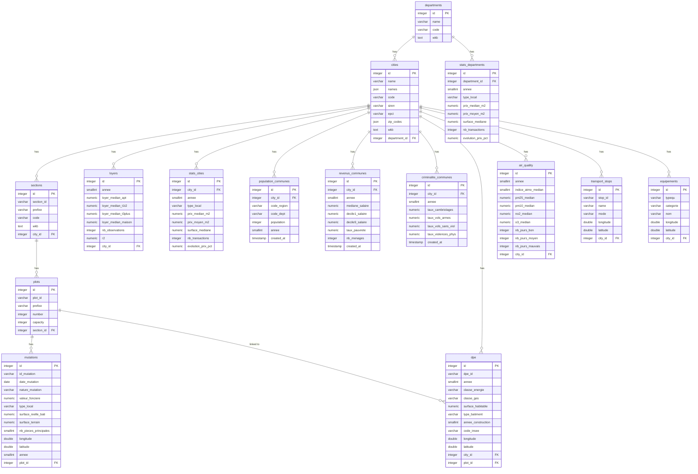

# Ressources

[TDAT902 Sharepoint](https://epitechfr.sharepoint.com/sites/TDAT902/Documents%20partages/Forms/AllItems.aspx?FolderCTID=0x012000F564A00B5E98FE4380EF0C645E31A70D&id=%2Fsites%2FTDAT902%2FDocuments%20partages%2Fdata)
[Databricks](https://docs.databricks.com/aws/en/getting-started/quick-start)
[Streamlit](https://streamlit.io/)

Mermaid : 

