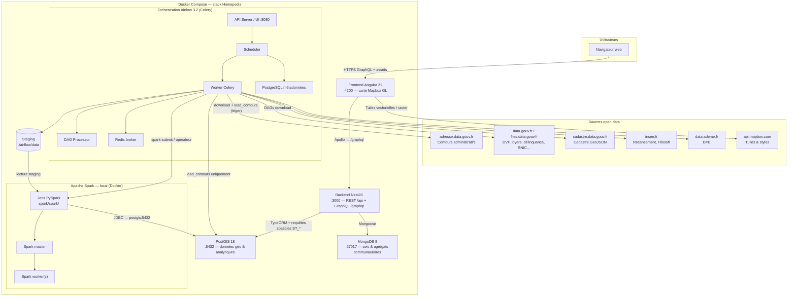
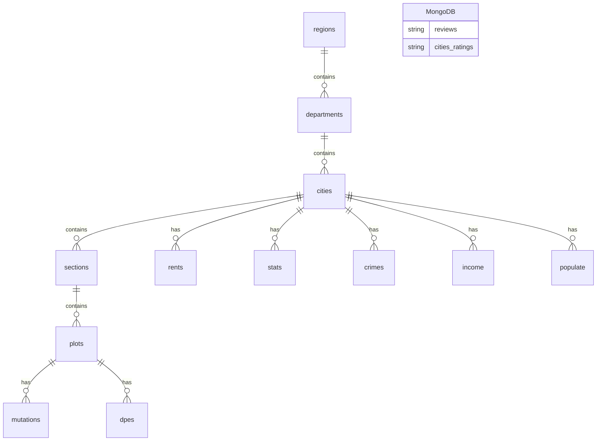
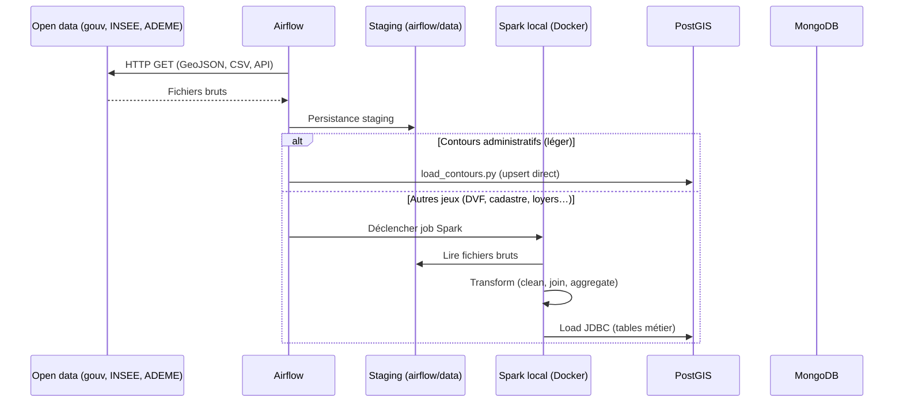
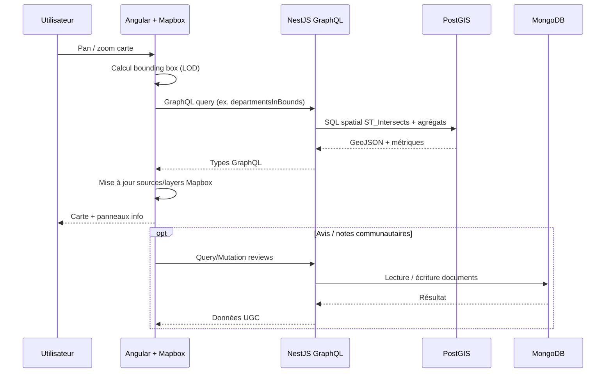

# Homepedia — Architecture globale

Plateforme d’exploration cartographique des territoires français : données publiques géoréférencées, indicateurs immobiliers et sociaux, avis utilisateurs.

## Diagramme d’architecture (vue conteneurs)



## Diagramme — modèle de données (simplifié)

Schéma relationnel détaillé : lien [DB Diagram (Mermaid Live)](https://mermaid.live/edit#pako:eNrVWF9v4jgQ_yqRn9sKQoHC657uZXXSPZ-QLCeZgreO7Y5trmy33_0mIQkkhJDu7T3cC1JmfjOe_2PzzlKTAVuzjQb8TYotinyjowhhK4120XvxEUVSe9gCRjKL_vx6JO0FpjuBkRY5tCmFxiPFw5uP_n5Jiq-P4icDK9DnoP0vV51KL-FzWr85o8tPd-2UmuIkgm6TwKbyTM13aXkh5y7NO1lzcp-TYb9_bYx3kPqR8a6gpKBNtwjP8m1UvE76KWiHjilWmVHJKXDDRtTCOuQJYOdgYUVxeJt68u3cojx4MTY6MuM1_MjIhIfyp0M_VYMP2GWSxYAyJZCCgPzZ6FQCdmLrDxa4MqlQbSEX8FmkwBFAKeAJ6e0HeEAUsjrS5UIpcizSCbcSUnDcoqRzLdlQFVVmQqIgUkZvpQ91ZmsqnXMiNuqE1tDJR5W58xArcwAcim-fvtqfUpjnkEmhubB-gOunPh5iz6wKbgCQC-nqJDXllXCTOMD9sUja0hjfLHhHmXf85vjo19AfmVslQpl9a1yK-3jk9CWrLpyjJFyEwaPQTqQ9YYC9UaFsrVK9TX3H_XGDeWiO_f8jYY0NqiwimuR5HvRP1cP56OXHNdrDoAj6Tlc2p1-Pppe0q7zIbZQi0EzLuDiZj7AHHdy_sX2oy6tQcyeUkNhhZpBKBdMh5qqf6UWgLIiwR_CXeaQSE9tmpw55n6LMpRZK0qT_jyJQmpqKPEFp1MmsFpuqy3GB-XWmo8rke9LQByAy6HL27w5jvM4sjFiKhGo29VCTpko4BxzoKriV_bwLr-tO3IlEekGLqKfvixVYDIs-CyhZ2nkMqe9vFKkdwKfX38CqoxLkr6EolMMn911DkzqT5LLwuakmUGdw5fH8CmM66WVoE_fSzaxFPuuMbyag44m5xinn5jUetRst0pubsZyi1qDnzhs76nJKuItL4eU1PjfZz-e0x1B4DdLC2GdFUZOvoVNr1Flbg92q1yb_lXbWr6ofP-7vzXvrNbSONmwn3IZ1n0kVtrqf3IJdbvOWRKWlBtevjgFMdTMc0nJ-fxrA9a3XAfjFOhvA9g7_Afz5DBiAdet_AHpegS1YE-M6CuXzqgU5kir-6bFzHVNM_YJLw-gFssibAsPu2BZlxtY0TOGO0fygyzJ9srIhNszvyLwNK-QygS-FyAfJWKH_MiavxdCE7Y6tn4Vy9BVs8XKq_hZoIKAzwC8maM_Wj4tSBVu_sze2vp_Nlg-rxXSymi2f5stVwT2wdTxdPkziJ6LGk8ViEs8eP-7Y9_LU6cPycf60jBerxeNqPptN53eMBp43-Mfxf4ny74mPfwCSDb26) (README racine).



---

## Description des composants

### Frontend (Angular)

| Élément | Rôle |
|--------|------|
| **Application** (`frontend/`) | SPA zoneless (Angular 21), routing, UI PrimeNG. |
| **Carte** (`features/map/`) | Facade Mapbox GL, overlays par niveau de zoom (régions → départements → communes → sections → parcelles). |
| **Services GraphQL** | `apollo-angular` interroge le backend via `/graphql` (proxy dev ou même origine en prod). |
| **Config runtime** | `public/env.js` injecte `MAPBOX_TOKEN` au démarrage Docker. |

**Responsabilité** : affichage interactif, requêtes géo-filtrées selon la bounding box visible, expérience utilisateur.

### Backend (NestJS)

| Élément | Rôle |
|--------|------|
| **API GraphQL** (`@nestjs/graphql` + Apollo) | Point d’entrée principal : `regions`, `departmentsInBounds`, `citiesInBounds`, `sectionsInBounds`, `sectionsByCity`, `plotsInBounds`, `plotsBySection`, `ping`. |
| **REST** (`/api`) | Health check (`/api/health`) pour orchestration et supervision. |
| **TypeORM → PostGIS** | Entités géographiques hiérarchiques et données analytiques (loyers, DVF agrégé, délinquance, DPE, recensement…). Requêtes spatiales (`ST_Intersects`, `ST_AsGeoJSON`). |
| **Mongoose → MongoDB** | Contenu collaboratif : avis (`reviews`), notes agrégées par commune (`cities`). |
| **Migrations** | Schéma PostGIS versionné (`backend/src/migrations/`). |

**Responsabilité** : agrégation, filtrage spatial, exposition typée au front, séparation données référentielles / UGC.

### PostGIS (PostgreSQL + extension spatiale)

- **Données** : géométries `MultiPolygon` SRID 4326, hiérarchie administrative, cadastre (sections, parcelles), transactions (mutations DVF), indicateurs communaux/départementaux.
- **Accès** : backend (runtime), Airflow (`load_contours`), Spark (chargement des jeux lourds via JDBC).
- **Persistance** : volume Docker `postgis_data`.

### MongoDB

- **Données** : documents flexibles pour avis et notations multi-critères (sécurité, éducation, etc.).
- **Justification** : schéma évolutif, écritures utilisateur sans migrations lourdes sur le modèle relationnel géo.

### Apache Airflow (orchestration & ingestion légère)

| Service Compose | Rôle |
|-----------------|------|
| `airflow-scheduler` | Planification des DAGs (`@monthly`, etc.). |
| `airflow-worker` | Téléchargements HTTP, chargement direct des contours, déclenchement/supervision des jobs Spark. |
| `airflow-dag-processor` | Parsing et synchronisation des DAGs. |
| `airflow-apiserver` | UI et API (:8080). |
| `airflow-triggerer` | Tâches deferrables. |
| `airflow-postgres` / `airflow-redis` | Métadonnées et file Celery (isolés de PostGIS applicatif). |

**Répartition des responsabilités ETL** :

| Couche | Technologie | Périmètre |
|--------|-------------|-----------|
| **Extract** | Airflow (Python) | Téléchargement des jeux open data vers `./airflow/data` (volume partagé avec Spark). |
| **Transform (léger)** | Airflow + `load_contours.py` | Contours administratifs : upsert direct PostGIS (volume modeste, pas de Spark). |
| **Transform (lourd)** | **Apache Spark local** (PySpark, cluster Docker) | DVF, cadastre, loyers, DPE, délinquance, INSEE, RNIC : nettoyage, typage, jointures, agrégations. |
| **Load** | Spark → JDBC PostgreSQL | Tables métier PostGIS (`sections`, `plots`, `mutations`, `rents`, `stats`, etc.). |

**DAGs d’ingestion** (`airflow/dags/`) :

| DAG | Source | Extract (Airflow) | Transform / Load |
|-----|--------|-------------------|------------------|
| `download_contours_administratifs` | adresse.data.gouv.fr | GeoJSON.gz | **Airflow** → PostGIS (`regions`, `departments`, `cities`) |
| `download_cadastre` | cadastre.data.gouv.fr | `./airflow/data/cadastre` | **Spark** → `sections`, `plots` |
| `download_dvf` | files.data.gouv.fr/geo-dvf | `./airflow/data/dvf` | **Spark** → `mutations`, `stats_*` |
| `download_carte_loyers` | API data.gouv.fr | `./airflow/data/carte_loyers` | **Spark** → `rents` |
| `download_delinquance_communale` | data.gouv.fr | staging | **Spark** → `crimes` |
| `download_ademe_dpe` | data.ademe.fr | staging | **Spark** → `dpes` |
| `download_filosofi` / `download_recensement` | insee.fr | staging | **Spark** → `income`, `populate` |
| `download_rnic` | data.gouv.fr | staging | **Spark** (selon modèle cible) |

**Plugin** : `airflow/plugins/load_contours.py` — seul chargement PostGIS côté Airflow (hors Spark).

**Volume partagé** : `./airflow/data` → `/opt/airflow/data` — zone de staging consommée par les jobs Spark.

Voir aussi [README_AIRFLOW.md](./README_AIRFLOW.md).

### Apache Spark (local, Docker)

- **Rôle** : pipeline batch pour les jeux volumineux ou multi-fichiers (CSV.gz DVF, cadastre national, séries temporelles INSEE).
- **Pourquoi Spark** : parallélisation, API DataFrame/SQL pour jointures à grande échelle, même stack reproductible sur la machine de chaque dev.
- **Déploiement** : cluster Spark **local** via `docker compose` (pas de Databricks ni cloud) — services `spark-master` / `spark-worker` à ajouter, scripts PySpark dans `spark/` (à créer).
- **Intégration** : Airflow enchaîne *download* puis `spark-submit` (ou `DockerOperator`) ; jobs lisent `/opt/airflow/data`, écrivent sur `postgis:5432` (réseau Compose).
- **Mode dev minimal** : `local[*]` sur la machine hôte possible pour prototyper hors cluster, mais la cible projet reste **100 % locale dans Docker**.

### Sources externes (hors dépôt)

- **Mapbox** : fond de carte et tuiles (token `MAPBOX_TOKEN`).
- **Open data français** : jeux listés dans les DAGs ; hébergement projet [SharePoint TDAT902](https://epitechfr.sharepoint.com/sites/TDAT902).

### POC benchmark (`docs/POC/benchmark/`)

Hors stack production : comparaison Next / Nuxt / Angular / Streamlit sur rendu cartographique LOD. N’alimente pas directement le backend Homepedia.

---

## Flux de données end-to-end

### 1. Ingestion batch (offline)



**État actuel** : source → PostGIS **opérationnel** pour les contours (Airflow seul). Les autres DAGs alimentent le **staging** ; le traitement **Spark → PostGIS** est la cible d’implémentation pour `plots`, `mutations`, `rents`, etc.

### 2. Requête utilisateur (online)



**Exemple concret** : `departmentsInBounds` exécute une enveloppe `ST_MakeEnvelope` sur `departments.geom` et joint les stats DVF agrégées (`stats_departments`) pour le prix médian au m².

### 3. Déploiement local

```bash
docker compose up --build
```

Ordre de démarrage : PostGIS + MongoDB → Backend (health) → Frontend ; stack Airflow après `airflow-init` ; Spark local avec les mêmes volumes/réseau Compose (à intégrer).

**Principe** : aucun service cloud (Databricks) — extract, transform et load tournent sur l’environnement local du projet.

---

## Justification des choix technologiques

| Choix | Alternatives envisagées | Pourquoi ce choix |
|-------|-------------------------|-------------------|
| **Angular** | React, Vue (benchmark POC) | Framework structuré, tooling entreprise, équipe/formation Epitech ; POC benchmark a validé Angular + Mapbox pour le LOD cartographique. |
| **NestJS** | Express pur, Fastify | Modules, DI, écosystème GraphQL/TypeORM/Mongoose cohérent ; typage TypeScript bout-en-bout avec le front. |
| **GraphQL** | REST uniquement | Requêtes géo-filtrées sur mesure (bounds, relations) sans sur-fetch ; contrat unique pour la carte multi-échelles. |
| **PostGIS** | Mongo géospatial seul, Elasticsearch geo | Jointures admin + stats + requêtes SQL spatiales matures ; modèle hiérarchique (région → parcelle) et indexes `GIST`. |
| **MongoDB** | Tables SQL pour avis | Schéma flexible pour critères de notation et commentaires ; charge d’écriture UGC découplée du référentiel géo. |
| **Mapbox GL** | Leaflet, MapLibre seul | Performances WebGL, écosystème tuiles, intégration éprouvée ; token géré côté client. |
| **Airflow 3 + Celery** | Cron, Dagster | Orchestration extract + chargements légers ; point d’entrée pour déclencher Spark. |
| **Apache Spark (local)** | Databricks, Pandas seul sur gros volumes | Transformations lourdes sans SaaS ; cluster Docker sur le même réseau que PostGIS et Airflow. |
| **Docker Compose** | K8s, cloud managé | Une commande pour front, back, BDD, Airflow et Spark ; pas de dépendance compte cloud. |
| **TypeORM + migrations** | Synchronize seul en prod | Schéma PostGIS versionné ; `synchronize` limité au dev. |
| **Python (DAGs Airflow)** | Node ETL | Téléchargements et `load_contours` ; pas de transformation lourde dans le worker Celery. |

---

## Évolutions prévues (architecture)

1. **Services Spark dans `compose.yaml`** : master + worker, image officielle, volumes `./airflow/data` et `./spark`.
2. **Jobs PySpark** : un job par jeu (DVF, cadastre, …), écriture JDBC PostGIS alignée sur les entités NestJS.
3. **DAGs Airflow** : tâche `spark-submit` après chaque `download_*` concerné.
4. **Smoke test** : DAG `homepedia_stack_smoke` — à (re)créer (voir [README_AIRFLOW.md](./README_AIRFLOW.md)).
5. **Production** : même topologie locale ou VM dédiée (pas de Databricks) ; reverse proxy, `synchronize: false`, build frontend statique.

---

## Liens utiles

- [README racine](../README.md) — démarrage rapide
- [README Airflow](./README_AIRFLOW.md) — opérations DAG
- [POC benchmark carto](./POC/benchmark/README.md)
