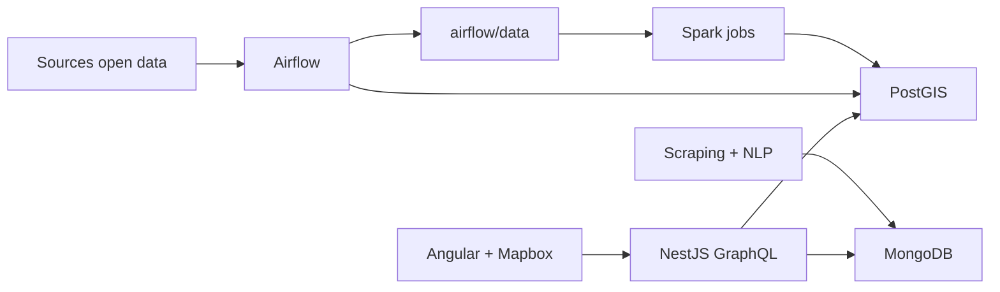

# Documentation projet Homepedia

Homepedia est une application cartographique d'analyse territoriale. Elle croise
des donnees immobilieres, cadastrales, energetiques, sociales,
environnementales et des avis utilisateurs pour aider a comparer une commune ou
une parcelle.

## Objectifs

- Visualiser les territoires francais sur une carte interactive.
- Comparer les communes avec des filtres : prix au m2, densite, criminalite,
  loyers et qualite de l'air.
- Explorer une parcelle avec ses ventes DVF, DPE rattaches et equipements
  proches.
- Enrichir les donnees publiques avec des avis utilisateurs et une analyse NLP.
- Orchestrer les ingestions open data de maniere reproductible avec Airflow et
  Spark.

## Fonctionnalites

### Carte

| Niveau | Contenu |
| --- | --- |
| Regions / departements | contexte administratif |
| Communes | choroplethes et selection commune |
| Sections cadastrales | stats immobilieres locales |
| Parcelles | details DVF, DPE et equipements |

Filtres disponibles :

- prix au m2 ;
- densite de population ;
- criminalite ;
- loyers ;
- qualite de l'air ;
- equipements BPE en couche ponctuelle.

### Details commune

Le panneau commune affiche :

- avis et synthese NLP ;
- population et historique ;
- criminalite ;
- loyers ;
- qualite de l'air.

### Details parcelle

Le panneau parcelle affiche :

- surface et prix moyen ;
- equipements BPE proches ;
- DPE rattaches ;
- mutations DVF rattachees.

## Architecture

La stack est locale et conteneurisee avec Docker Compose.

| Composant | Technologie | Role |
| --- | --- | --- |
| Frontend | Angular, Mapbox GL, Apollo, PrimeNG | carte, filtres, panneaux |
| Backend | NestJS, GraphQL, TypeORM, Mongoose | API applicative |
| Base relationnelle | PostgreSQL + PostGIS | geometries et indicateurs |
| Base document | MongoDB | avis, notes, resultats NLP |
| Orchestration | Airflow 3 | DAGs d'ingestion et pipelines |
| Traitement batch | Spark local Docker | nettoyage et chargements lourds |

Flux de donnees simplifie :



## Donnees

| Source | Stockage | Usage |
| --- | --- | --- |
| Contours administratifs | `regions`, `departments`, `cities` | base geographique |
| Cadastre Etalab | `sections`, `plots` | sections et parcelles |
| DVF / geo-dvf | `mutations`, `mutation_locals`, `stats_*` | ventes et prix |
| ADEME DPE | `dpes` | energie/GES |
| ANIL loyers | `rents` | loyers communaux |
| INSEE recensement | `populate_cities` | population, densite |
| INSEE Filosofi | `income_cities` | revenus |
| SSMSI delinquance | `crimes_cities` | criminalite |
| INSEE BPE | `devices` | equipements proches |
| Atmo Data | `air_quality` | qualite de l'air |
| Bien dans ma ville | MongoDB `reviews`, `cities` | avis et NLP |

La methodologie de nettoyage est detaillee dans
[METHODOLOGIE_NETTOYAGE.md](./METHODOLOGIE_NETTOYAGE.md).

## Airflow

Tous les DAGs metier sont configures en manuel uniquement (`schedule=None`) et
pauses par defaut. Demarrer Airflow ne doit pas lancer de pipeline de donnees.

| DAG | Role |
| --- | --- |
| `download_contours_administratifs` | contours regions/departements/communes |
| `download_cadastre` | sections et parcelles |
| `download_dvf` | mutations et stats DVF |
| `download_ademe_dpe` | DPE ADEME |
| `download_bpe_equipements` | equipements BPE |
| `download_air_quality` | qualite de l'air Atmo |
| `download_carte_loyers` | loyers ANIL |
| `download_delinquance_communale` | criminalite |
| `download_filosofi` | revenus |
| `download_recensement_populations_legales` | population |
| `download_rnic` | coproprietes |
| `pipeline_avis_nlp` | scraping avis, sentiment, wordcloud |

Guide detaille : [README_AIRFLOW.md](./README_AIRFLOW.md).

## API backend

Le backend expose une API GraphQL sur `/graphql`.

Requetes principales :

- `regions`, `departmentsInBounds`, `citiesInBounds` ;
- `sectionsInBounds`, `sectionsByCity` ;
- `plotsInBounds`, `plotDetails` ;
- `cityPopulation`, `cityCrime`, `cityRent`, `cityAirQuality` ;
- `devicesInBounds`, `devicesNearPlot` ;
- `priceLegend` ;
- `cityInsights`.

Le endpoint REST `/api/health` sert aux healthchecks.

## Lancement local

Preparer un fichier `.env` a partir de `.env.example`, puis lancer :

```bash
docker compose up --build
```

URLs :

| Service | URL |
| --- | --- |
| Frontend | http://localhost:4200 |
| Backend REST | http://localhost:3000/api |
| GraphQL | http://localhost:3000/graphql |
| Airflow | http://localhost:8080 |

Variables importantes :

| Variable | Role |
| --- | --- |
| `MAPBOX_TOKEN` | carte Mapbox |
| `POSTGIS_HOST`, `POSTGIS_PORT`, `POSTGRES_*` | PostGIS |
| `MONGODB_HOST`, `MONGODB_PORT`, `MONGO_*` | MongoDB |
| `ATMO_USERNAME`, `ATMO_PASSWORD` | API Atmo Data |
| `AIRFLOW_UID`, `_AIRFLOW_WWW_USER_*` | Airflow |

## Commandes utiles

Build backend :

```bash
docker compose exec -T backend npm run build
```

Build frontend :

```bash
docker compose exec -T frontend npm run build
```

Verifier les imports Airflow :

```bash
docker compose exec -T airflow-scheduler airflow dags list-import-errors
```

Declencher un DAG :

```bash
docker compose exec airflow-scheduler airflow dags trigger <dag_id>
```

Relancer le parser de DAGs :

```bash
docker compose restart airflow-dag-processor airflow-scheduler
```

## Validation

Avant une livraison, verifier au minimum :

- build backend ;
- build frontend ;
- absence d'erreurs d'import Airflow ;
- DAGs importants en pause si aucun traitement ne doit partir ;
- donnees presentes dans PostGIS/MongoDB pour les fonctionnalites testees.

## Limites connues

- Les sources open data peuvent changer de format.
- L'API Atmo peut time-out sur de grosses periodes ; le DAG decoupe les appels
  avec `ATMO_WINDOW_DAYS`.
- Les indicateurs PM2.5, PM10, NO2 et O3 stockes depuis Atmo sont des
  sous-indices ATMO, pas des concentrations physiques.
- Le NLP depend d'une source d'avis unique et peut porter les biais de cette
  source.
- Les performances carte dependent du volume affiche ; les appels sont limites
  par bounding box et caches cote front.

## Documentation associee

- [Architecture](./ARCHITECTURE.md)
- [Airflow](./README_AIRFLOW.md)
- [Spark](./README_SPARK.md)
- [Methodologie de nettoyage](./METHODOLOGIE_NETTOYAGE.md)
- [IA / NLP](./IA_NLP.md)
